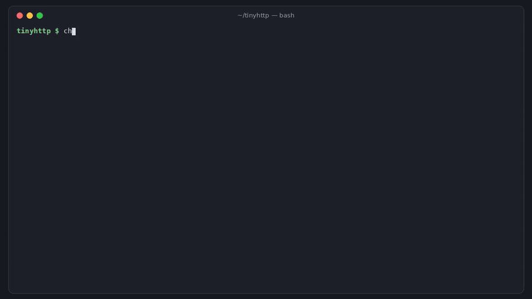

# checkrefs

[](https://github.com/hamarshehmhmd/checkrefs/actions/workflows/ci.yml)


[](LICENSE)

**Does this bug report match the code it cites?** checkrefs checks that the files, line numbers, functions,
quoted code, diffs, CLI options, versions and stack frames in a bug report, security report or PR actually exist
in your repo, so you can spot a made-up report in seconds instead of disproving it by hand for an hour.



> 🎬 2-minute narrated demo: [demo.mp4](https://github.com/hamarshehmhmd/checkrefs/releases/download/v0.1.0/demo.mp4)

## Why

Maintainers are getting confident, detailed reports about code that isn't there: invented functions, wrong files,
line 212 of a 28-line file, "vulnerable code" that was never in the repo.

- curl's Daniel Stenberg: ["We still have not seen a valid security report done with AI help"](https://news.ycombinator.com/item?id=43907376) and a [public list of slop reports](https://gist.github.com/bagder/07f7581f6e3d78ef37dfbfc81fd1d1cd) sent to curl
- ["You did this with an AI and you do not understand what you're doing here"](https://news.ycombinator.com/item?id=45330378) (HN, 1,100+ points)
- [Open source maintainers drowning in junk bug reports](https://news.ycombinator.com/item?id=42501922)

Each of these takes real time to rule out: look up every function, open every file, scroll to every line.
checkrefs does that lookup for you.

## Install

```sh
curl -fsSL https://raw.githubusercontent.com/hamarshehmhmd/checkrefs/main/install.sh | sh
```

Uses `uv tool`, then `pipx`, then a private venv. Or directly:

```sh
uv tool install git+https://github.com/hamarshehmhmd/checkrefs      # or: pipx install git+https://...
```

Python 3.9+, no dependencies, needs `git` for `--ref`/`--at`/tags.

## Usage

```sh
cd your-repo
checkrefs report.md                       # a report saved to a file
pbpaste | checkrefs -                     # from the clipboard / stdin
checkrefs owner/repo#123                  # an issue or PR (uses $GITHUB_TOKEN / $GH_TOKEN if set)
checkrefs report.md --ref v1.4.0          # against the version the reporter says they used
checkrefs report.md --at 2025-10-21       # against the code as it was when the report was filed
checkrefs report.md --format markdown     # paste-able table (also: json)
```

What it checks:

| reference in the report | check |
|---|---|
| `src/foo/bar.c`, `bar.c:120`, `#L10-L20`, "line 212 of x.py", GitHub blob links | file exists (closest match if not), line is within the file |
| `foo.c:120 where strcpy(buf, x) is called` | the named code is actually near that line |
| `parse_headers()`, `Foo::bar` | identifier exists (in the cited file, if one is cited); a `curl_*`-style name that doesn't exist is flagged |
| quoted "vulnerable code" blocks | the lines are in the cited file (or anywhere), with the closest real code |
| ```` ```diff ```` blocks | removed/context lines exist |
| `mytool --flag` | option appears in the source |
| "mytool 2.1.0", "Version: 2.1.0" | a matching release tag exists, and it isn't newer than the latest |
| Python, JS/TS, Java and Go stack frames | file, line, function (and source line, for Python) match |

Exit codes: `0` nothing wrong, `1` wrong references (`--fail-on warn` also counts doubtful ones, `--fail-on never`
always exits 0), `2` usage or input error.

Results per reference are **ok**, **FAIL** (contradicts the code), **WARN** (couldn't confirm: maybe a dependency,
a different version, or the reporter's own file) or **skip** (system headers, third-party paths, other repos).

## GitHub Action

Check every new issue and add a job summary (and optionally a label) when its references don't match the code:

```yaml
# .github/workflows/checkrefs.yml
on:
  issues:
    types: [opened, edited]
permissions:
  contents: read
  issues: write          # only needed for `label`
jobs:
  checkrefs:
    runs-on: ubuntu-latest
    steps:
      - uses: actions/checkout@v4
        with:
          fetch-depth: 0   # tags, for version checks
      - uses: hamarshehmhmd/checkrefs@v0.1.0
        with:
          label: needs-repro   # optional
```

It never comments or closes anything. The verdict is also available as `steps.<id>.outputs.verdict`.

## Honest limits

checkrefs checks **references**, not reasoning, and it does not try to guess who or what wrote a report.
A report can cite real code and still be wrong.

I ran it on a sample of 16 of the 49 reports on curl's [public slop list](https://gist.github.com/bagder/07f7581f6e3d78ef37dfbfc81fd1d1cd)
(2023 to 2025, each against the curl release current when it was filed):

- **2** cite code that doesn't exist (e.g. `curl_easy_setopt_timeout()`, and `Curl_ldap_err2string(char *, char *)`
  where the real function is `Curl_ldap_err2string_a(int)`): **ungrounded**
- **8** have references it couldn't confirm (libc internals like `__strcpy_evex`, `memcpy_s`, the reporter's own
  PoC code, a line number from a newer commit): **partly verified**
- **6** cite real code, real lines and real functions, and are still wrong about what the code does: **grounded**

So: an *ungrounded* verdict is a strong signal to ask for a reproduction first; a *grounded* one only means the
report is talking about real code. Also:

- Shallow clones have incomplete tags, so version checks are skipped there (`fetch-depth: 0` in Actions).
- Paths are matched by suffix, so `site-packages/yourpkg/x.py` and `curl/lib/x.c` resolve to your files.
- Heuristics decide which code blocks are "quotes of your code" (vs. PoCs and shell sessions); single-file names
  that aren't in the repo are assumed to be the reporter's own files.

## Demo

[`demo.mp4`](https://github.com/hamarshehmhmd/checkrefs/releases/download/v0.1.0/demo.mp4) (2:22, narrated) runs
checkrefs on [a made-up report](examples/reports/slop.md) and [a real one](examples/reports/real-bug.md) against
[examples/tinyhttp](examples/tinyhttp), then on a real curl HackerOne report. Try it yourself:

```sh
sh examples/make_repo.sh /tmp/tinyhttp
checkrefs examples/reports/slop.md -C /tmp/tinyhttp       # UNGROUNDED, exit 1
checkrefs examples/reports/real-bug.md -C /tmp/tinyhttp   # GROUNDED, exit 0
```

The video is rendered from real command output by [`demo/render.py`](demo/render.py).

## Development

```sh
pip install -e . pytest && pytest
```

## License

[GNU AGPL-3.0-or-later](LICENSE). **Commercial licenses** without the AGPL obligations are available from the
author: Mohammad Hamarsheh ([@hamarshehmhmd](https://github.com/hamarshehmhmd)). Open an issue to get in touch.
